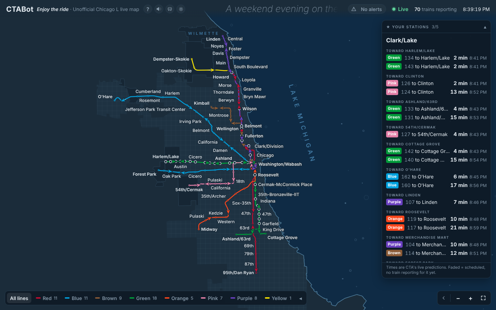
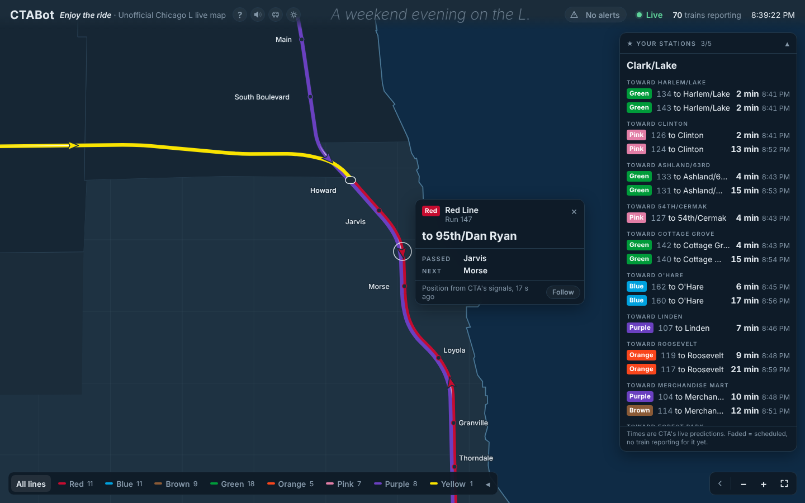
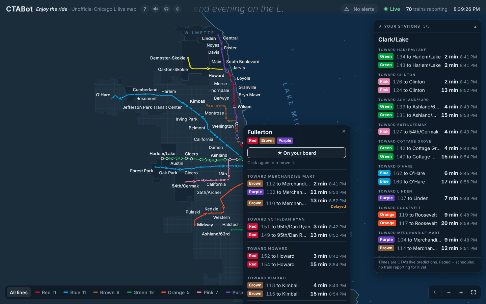
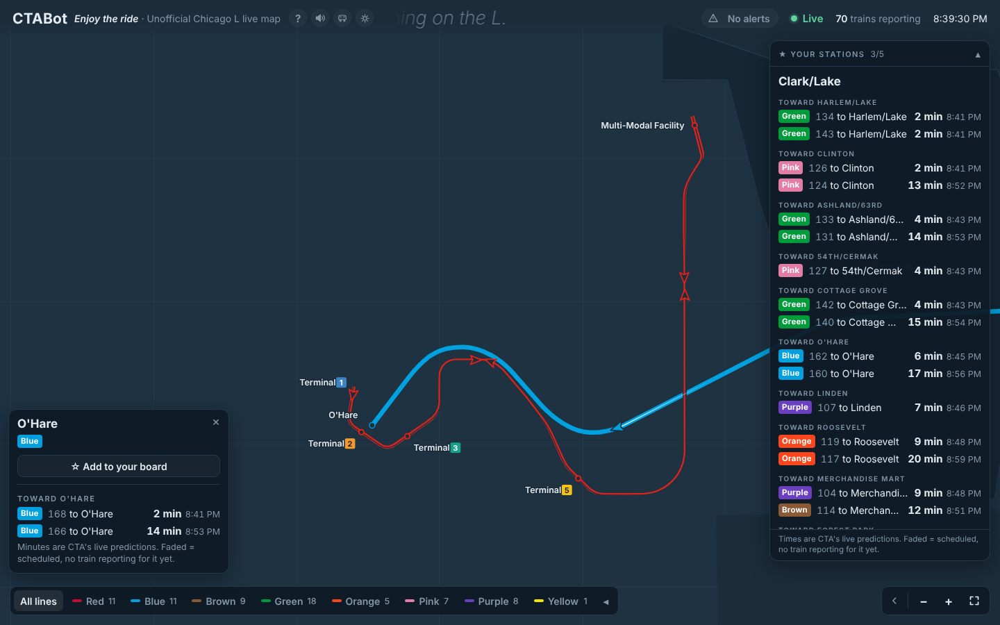
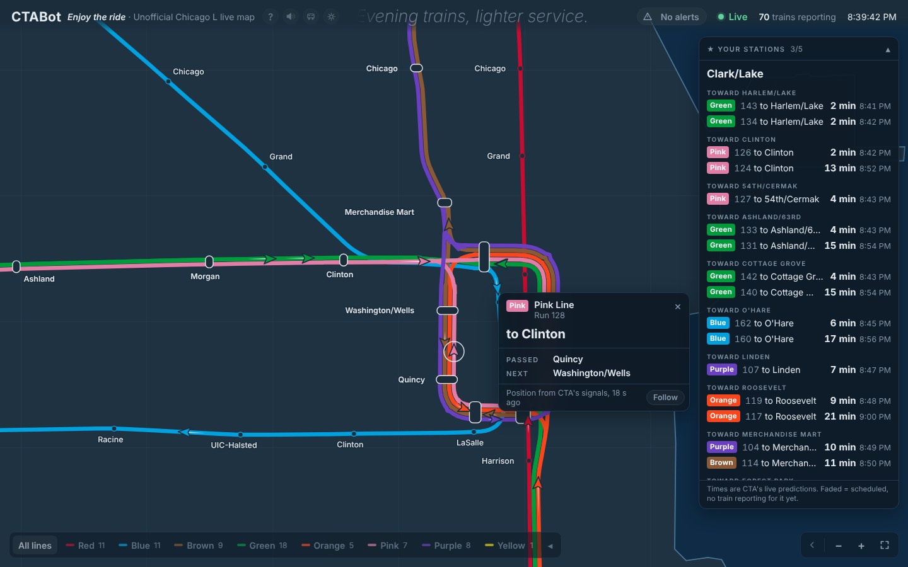
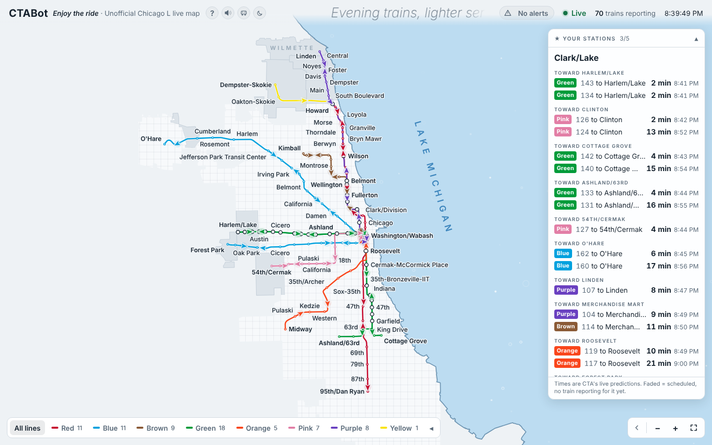
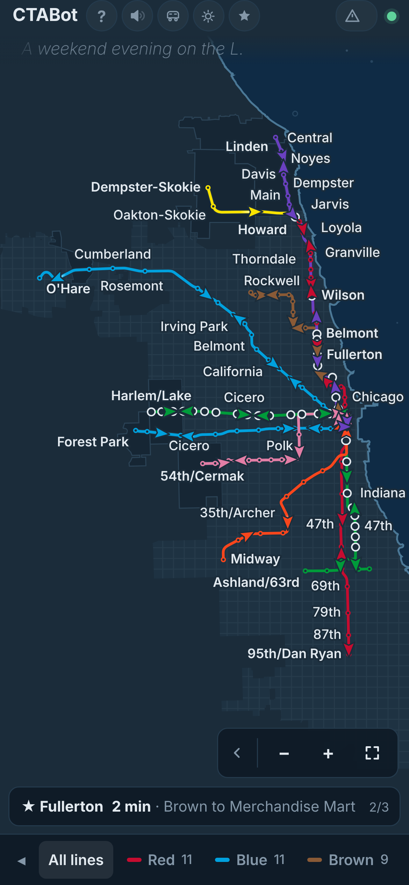
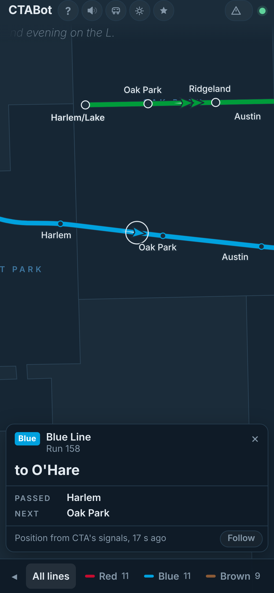
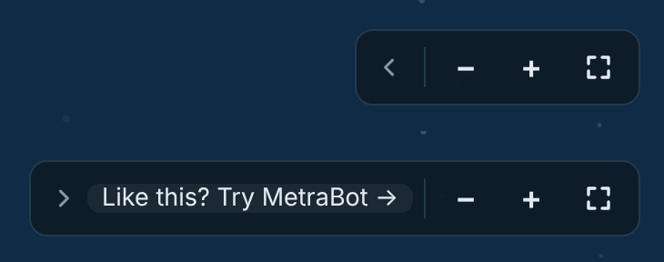

# CTABot

*Enjoy the ride.*

An unofficial live map of every CTA 'L' train, built on [MetraBot](https://github.com/evan-dawkins/metrabot)'s engine. Real positions only: nothing is guessed (the one exception, O'Hare's airport train, is clearly marked as simulated).

**Not affiliated with the Chicago Transit Authority (CTA).**

**Live:** https://evan-dawkins.github.io/ctabot/

Screenshots on this page use sample data.

- **The map is real geography.** Every line follows CTA's own track shapes, over the real Lake Michigan shoreline, with Chicago's street grid and the suburbs the L runs through (Evanston, Wilmette, Skokie, Rosemont, Oak Park, Forest Park, Cicero). Nothing is enlarged: the Loop is its true size, so zoom in to read it. Lines that share track are drawn side by side, each keeping its own full stripe when you zoom in. As on CTA's own map, the Loop runs straight along Lake, Wabash, Van Buren and Wells, and bends are drawn (and run) as smooth curves.
- **Trains** come from CTA Train Tracker every 30 seconds. CTA's cars have no GPS: positions come from its signal system, sit within a few metres of the real track, and each train's is refreshed about every 30 seconds, so a train on the map is typically 30 to 60 seconds behind real life. Each one is placed on its own line's real track (CTA's "next station" tells apart the two passes where a line runs over the same track, as into and around the Loop) and glides only between real reported positions. L trains stop at every station they serve, so when a glide passes a station (or ends at one) the train slows in, waits there for up to 20 seconds, and pulls away, as long as the time between CTA's reports allows it at a believable speed. CTA reports where trains are, not when they stopped, so the moment of each pause is estimated; the train is always at CTA's reported spot when the next report comes in. A one-off report that jumps a train backwards is ignored unless CTA repeats it.
- **Click a train** to see where it's headed and its next stop. **Click a station** to see CTA's arrival predictions, and ☆ to pin it to your board.
- **The line bar** at the bottom shows one line on its own, and folds away.
- **Sound:** brown noise, water, or sonar (with a radar sweep over the Loop).
- **Train of the moment:** leave it alone for 2 minutes (20 seconds on a phone, which stays awake while it rides) and the camera rides along with a live train, and a calm voice checks in on it: the line, where it's headed, the next stop and how far off it is, from CTA's live data. Each ride lasts about 50 seconds, with check-ins at the start, halfway and the end, then a 25-second rest before the next train. The check-ins keep going in a background tab, so you can listen while you work. Turn the voice off in the sound menu (Train check-ins). Close the train's card (×) to stop.
- **O'Hare's Airport Transit System** (the free people mover between Terminals 1, 2, 3, 5 and the Multi-Modal Facility) appears when you zoom in at the airport, or click O'Hare. Its track and stations are real, but **its trains are simulated**: the airport publishes no live data, so they follow its published pattern (every 3–5 minutes, 24/7). They're drawn hollow, their cards say so, and they never count as L trains.
- **MetraBot:** a small **‹** beside the zoom buttons links to [MetraBot](https://evan-dawkins.github.io/metrabot/), the same kind of map for Metra. Point at it and the link slides out; move away and it folds back. On a phone, tap it.
- **Service alerts** from CTA, plus a live ticker under the title: live numbers off the map (trains running, the busiest line, trains around the Loop) alternating with what the L is doing at this hour.

## A look around

**Click a train** for where it's headed and its next stop.

**Click a station** for CTA's arrival times, grouped by direction. Pinned stations stay on the board at the right.

**O'Hare** shows the Airport Transit System between the terminals. Its trains are simulated and drawn hollow.

**Train of the moment** rides along with a live train when you leave the page alone.

**Light mode,** and **on a phone:**

**The MetraBot link,** folded and slid open:

## How it's built

| Piece | What it does |
| --- | --- |
| `index.html` | The whole page. The map data is baked in, so it also works opened as a file. **Generated: edit `src/`, not this** (see `src/README.md`). |
| `src/` | The page's source: CTA code blocks plus a pinned copy of MetraBot's engine, put together by `src/assemble.py`. |
| `tools/build_stations.py` | Downloads CTA's GTFS timetable and saves stations, stop patterns and track shapes (`data/stations.json`). |
| `tools/build_geo.py` | Downloads the Census TIGER shoreline and town boundaries (`data/geo.json`). |
| `tools/build_ats.py` | Downloads O'Hare's Airport Transit System track and stations from OpenStreetMap (`data/ats.json`). |
| `tools/build_layout.py` | Builds the map from those (`data/network.json`) and writes it into `index.html`. |
| `tools/build_voice.py` | Records the check-in voice with Kokoro, a free open-source voice (`voice/`). |
| `docs/` | The screenshots on this page. |
| Cloudflare Worker | Shared with MetraBot (`metrabot/worker.js`, the `/cta/` routes). It holds the CTA key, so the key never reaches the page. |

GitHub Actions rerun the station download every Monday, and the outline and airport-train downloads whenever their builders change. Both rebuild the map.

Not affiliated with the Chicago Transit Authority. Data provided by the CTA. Map outlines: US Census Bureau TIGER/Line. Airport Transit System track: © OpenStreetMap contributors (ODbL). The Airport Transit System is run by the Chicago Department of Aviation.
